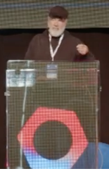
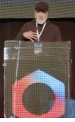
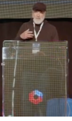
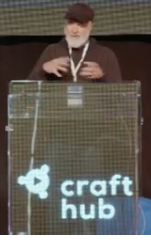

<!-- markdownlint-disable MD033 -- sized inline images need  -->

Does your conference podium flash at the audience?

If so, then it is squandering attention that is not yours to redirect.

> _`[ >>> Squirrel. Redirect eyes. Lose context. ]`_
>
> 
>
> _`[ <<< Refocus. Pay context-switch penalty. Start rebuilding mental models. ]`_

If so,

**STOP IT.**

**STOP IT.**

**STOP IT.**

I noticed the problem while watching [Michael Feathers at Craft Conference](https://www.youtube.com/watch?v=Mcsb4_7U-LY&t=2092s). I could not follow him until I restarted the video and covered the podium with my hand.

> _`[ >>> Squirrel (as above). ]`_
>
> 
>
> _`[ <<< Refocus (as above). ]`_

Attendees paid for that attention with money, travel, and days away from work. They paid to give their attention and focus to your speakers.

> _`[ >>> Squirrel (as above). ]`_
>
> 
>
> _`[ <<< Refocus (as above). ]`_

Brains are hard-wired to shift attention to flashing and movement. That happens in the "lizard brain," bypassing the higher-level executive functions that are critical to processing and comprehending the speaker's message. Hijack the lizard brain, and attendees can no longer choose to give the speaker their full attention. Looking is automatic, not a free choice.

> _`[ >>> Squirrel (as above). ]`_
>
> 
>
> _`[ <<< Refocus (as above). ]`_

So a flashing podium does not invite attention. It seizes it. It takes away people's freedom to choose where they look.

Accessibility standards already say so. [WCAG 2.2, Success Criterion 2.2.2 (Pause, Stop, Hide)](https://www.w3.org/TR/WCAG22/#pause-stop-hide) requires a way to pause, stop, or hide moving content that starts automatically and runs longer than five seconds. A podium has no pause button.

> _`[ >>> Squirrel (as above). ]`_
>
> 
>
> _`[ <<< Refocus (as above). ]`_

Taking control of someone's body without consent has a legal name: assault (or worse). Taking control of their focus is wrong for the same reason. It is theirs, not yours.

Every flash breaks the thread. Every recovery fractures the context people need to follow the world-class content your speakers created. Neither speaker nor attendee ever gets that back.

> _`[ >>> Squirrel (as above). ]`_
>
> 
>
> _`[ <<< Refocus (as above). ]`_

Does your podium flash?

If so,

**STOP IT.**

**STOP IT.**

**STOP IT.**

Build a grown-up stage, not one that shouts "Look at me! Look at me!" like a 4-year-old or a 2000s website.

Give the audience what they paid for and what your speakers prepared for: an environment where learning and critical thinking can happen.
